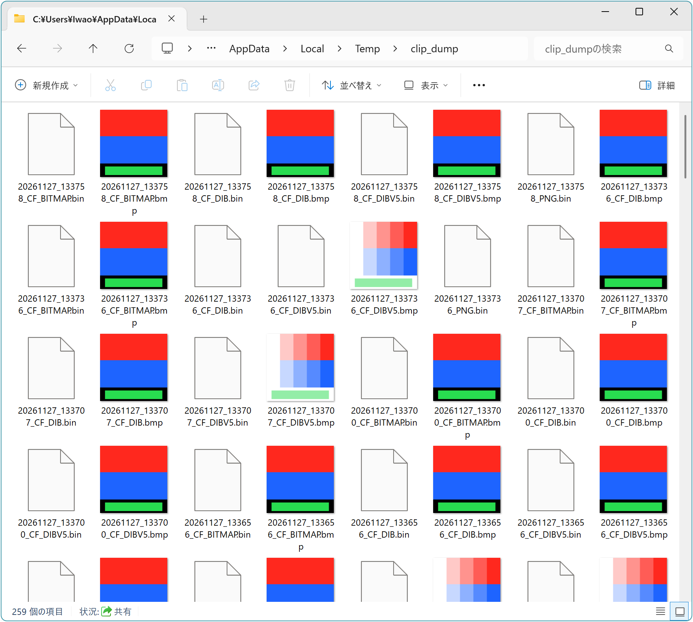

# ClipDmp

クリップボード画像ダンプ

## 概要

クリップボードに画像フォーマットが置かれるのをポーリング監視し、検出時にデータをダンプします。クリップボードビューアチェーンは使用しません。

- **出力先:** 一時フォルダ配下の `clip_dump`（例: `%TEMP%\clip_dump`）に `YYYYMMDD_HHMMSS_<フォーマット名>.bin` / `.bmp` 形式で保存
- **キー操作:**
  - `Enter`: 次のクリップボード画像の待機を再開
  - `Q` / `q`: 終了

## 特長

- Win32 / GDI API のみで構成されており、MFC、GDI+、サードパーティライブラリは不使用
- Visual C++ 6.0（C++98 相当）から現代の Visual Studio 環境まで扱いやすい単一ソース構成
- 複数のクリップボード画像フォーマットに対応

## 対応フォーマットと出力仕様

- **`CF_DIB` / `CF_DIBV5`:** クリップボードデータを `.bin` で保存し、24-bit または 32-bit（`BI_RGB` / `BI_BITFIELDS` / `BI_ALPHABITFIELDS`）の DIB であれば 32-bit `BITMAPV4HEADER` BMP（`.bmp`）に変換して保存（非対応形式は `.bin` のみ）
- **`CF_BITMAP`:** 32-bit DIB 形式でシリアライズした `.bin` と、32-bit `BITMAPV4HEADER` BMP（`.bmp`）を保存
- **`CF_ENHMETAFILE`:** メタファイルビットを `.bin` で保存し、バウンディング矩形サイズでラスタライズした `.bmp` を保存
- **`CF_METAFILEPICT`:** WMF データを `.bin` で保存し、1024x768 ターゲットで再生・ラスタライズした `.bmp` を保存
- **登録済み `PNG`:** `.bin` のみ保存（PNG デコード処理は非搭載）

## 構成ファイル

- `ClipDmp.cpp`: クリップボード監視および各画像フォーマットのダンプ・BMP 出力処理
- `ClipDmp.dsp`: Visual C++ 6.0 向けプロジェクトファイル
- `ClipDmp.vcxproj`: Visual Studio / MSBuild 向けプロジェクトファイル

## ビルド方法と使い方

1. `ClipDmp.dsp`（VC6 など）または `ClipDmp.vcxproj`（Visual Studio）を開いてビルドします。
2. コマンドプロンプトから `ClipDmp.exe` を起動します。
   - 引数（任意）: ポーリング間隔を秒単位（`1`〜`60`）で指定します（省略時は `1000` ms）。
   - 例: `ClipDmp.exe 2`（2 秒間隔で監視）

## ライセンス・免責事項

本リポジトリのコードは ChatGPT を用いて作成されたものです。  
利用・改変・再配布などは自由に行って構いません。

本コードおよび公開情報の使用・運用により生じたいかなる損害や不具合についても、一切の責任を負いません。ご自身の判断と責任においてご利用ください。

- **作成:** ChatGPT / Iwao ( https://mish.work/ )

